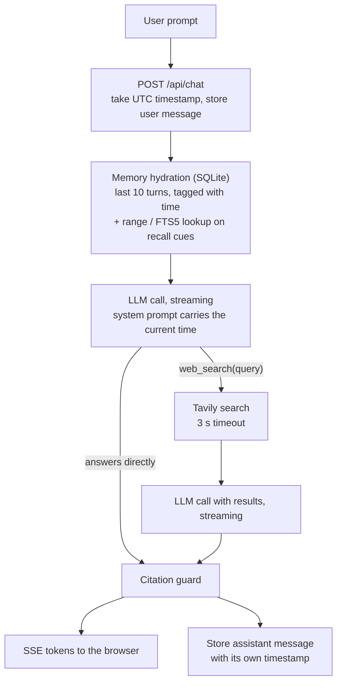

# Design

Chronos is a chat agent with one tool, web search. It was built against three goals: answer fast, get things right, and remember what was asked and when. This document explains how each goal is met, what was traded away, and what has and has not been verified.

## 1. Architecture

One request is one pass through this pipeline:

| Stage | Where | What happens |
| --- | --- | --- |
| 1. Ingress | `main.py`, `agent.py` | The UTC timestamp is taken at receipt and the user message is written immediately. |
| 2. Hydration | `temporal.py`, `memory.py` | The last 10 turns are loaded, each prefixed with its time. If the message contains a recall cue, time-range and keyword lookups run and their results are added to the system prompt. |
| 3. Routing | `agent.py`, `llm.py` | A single streaming LLM call. The model either starts answering or emits a `web_search` call. There is no separate router call. |
| 4. Search | `search.py` | The search runs with a 3 s timeout while the UI shows "Searching web…". |
| 5. Grounded answer | `agent.py`, `grounding.py` | A second streaming call answers from the results. Every token passes through the citation guard before it is sent. |
| 6. Persistence | `agent.py`, `memory.py` | The assistant message is written, also if the client disconnects mid-stream. |

**Single-tool constraint.** `agent.TOOLS` contains exactly one function declaration, `web_search(query)`, and every LLM request sends that list. Memory is not a tool: recall is done in code before the model is called, so the model cannot reach anything except search. A test asserts the list sent to the provider.

**No agent framework.** The LLM client is about 100 lines over `httpx`, speaking the OpenAI-compatible chat-completions format. Gemini (the default, through its compatibility endpoint) and OpenAI are both reached with the same code, and switching is a configuration change.

## 2. Latency

Targets from the brief: first token under 800 ms without search, under 1.8 s with search.

- **One round trip when no search is needed.** Routing is the first tokens of the answer call. A classifier or planner call in front would add a full round trip to every message.
- **Fast model, thinking off.** Gemini 2.5 Flash with `reasoning_effort: none`. Flash reasons before answering by default, which delays the first token.
- **Nothing blocks before the model call.** Hydration is a few indexed SQLite reads, measured in the low milliseconds, and recall parsing is regular expressions.
- **Connection reuse.** One pooled `httpx.AsyncClient` serves both the LLM and the search API, and the connections are opened at startup so the first question does not pay for TLS handshakes.
- **Searches run concurrently.** If the model asks for several searches in one step they run in parallel, with at most two search rounds per turn; on the last round the model must answer.
- **Streaming end to end.** Tokens are forwarded as they arrive. The citation guard holds text back only while it is inside a possible link, so ordinary prose is not delayed.
- **Small prompts.** The window is 10 turns, snippets are capped at 700 characters and five results.

Every answer reports `ttft_ms`, `search_ms` and `total_ms`, measured on the server from request receipt, in the `done` event and as badges in the UI.

**What is measured and what is not.** I could not run this against the live Gemini and Tavily APIs while building it, so there are no real latency numbers here, and the targets are unverified. Against a local stand-in for both APIs, the pipeline added roughly 20 ms to the first token on top of the stand-in's own delay. The badges make it straightforward to check the targets with real keys.

## 3. Accuracy and grounding

Grounding has two layers: instructions the model is asked to follow, and a filter it cannot bypass.

**System prompt rules** (`agent.SYSTEM_PROMPT`):

- The current date and time, in the user's timezone and in UTC, is injected on every request, with a note that training data is older. This stops the model treating its training cutoff as "now".
- Search for anything live, recent or uncertain. Do not search for small talk, reasoning, stable knowledge or questions about the conversation.
- After a search, base claims only on the results and cite each one inline as a markdown link using the result's exact URL.
- When answering without a search, give no URLs and say when the answer may be outdated.

**Citation guard** (`grounding.py`). The requirement is 0% fabricated URLs, and a prompt alone cannot guarantee that. Every streamed token goes through a filter holding the set of allowed URLs: the results returned this turn, plus URLs already present in the conversation. A markdown link or bare URL outside that set never reaches the user. For a link, the label text is kept and the URL dropped. The UI shows a badge when this happens, and the stored message is the filtered text. The filter is tested for identical output under every chunking of the stream.

The guard checks that a URL was retrieved. It does not check that the page supports the sentence it is attached to.

**Failure behaviour.** The tool result tells the model what happened, and the UI is told separately:

| Case | Behaviour |
| --- | --- |
| No results | Tool result instructs the model to say "I could not find verified information on this" and not to guess. |
| Timeout over 3 s | Search is abandoned, the UI shows "Search timed out", and the model may answer from its own knowledge only with an explicit disclaimer. |
| Search API error or missing key | Same as timeout, reported as unavailable. |
| LLM error | An `error` event with the provider's message. The user's question is still stored. |

## 4. Temporal memory

**Storage.** One SQLite file in WAL mode. The `messages` table follows the brief (`session_id`, `role`, `content`, `created_at`) plus a `meta` JSON column the UI uses for sources and latency. An FTS5 index over `content` is kept in sync by triggers and uses the Porter stemmer.

**Timestamps.** `created_at` is ISO-8601 UTC with fixed millisecond width, for example `2026-11-11T15:36:02.123Z`, so string order equals time order and range queries use the index. The user's timestamp is taken when the request arrives, the assistant's when its answer is complete. A trigger rejects every `UPDATE` on the table, so a stored time or text cannot be changed.

**What the model sees.** Each historical message is prefixed with a tag such as `[2026-11-11 21:01:10 IST · 5 min ago]`: the exact time in the user's timezone and its age, computed in code. Models are unreliable at clock arithmetic, so the subtraction is done for them.

**Recall.** A sliding window alone forgets anything older than 10 turns. When a message contains a recall cue ("earlier", "yesterday", "when did I ask", "5 minutes ago"), three lookups run before the model is called:

1. **Time range.** Phrases are resolved to exact UTC bounds in the user's timezone: "yesterday" is the user's calendar day, "5 minutes ago" is a window around that moment, "the last 2 hours" ends now. Also handled: today, this morning, last night, last week, weekday names and ISO dates.
2. **Keywords.** The remaining content words go to FTS5, ranked by BM25.
3. **Session log.** Every question the user asked in this session, in order. This answers "what did I ask earlier?" with no date.

The results go into the system prompt as a `MEMORY RECALL` section. An empty range is stated explicitly ("Nothing was recorded in this range") so the model reports no record instead of inventing one.

Range and keyword recall span all sessions, because the app is single-user and "yesterday" usually means a different session. The sliding window and session log are per session.

## 5. Trade-offs and future work

- **FTS5, not embeddings.** Keyword recall is exact, fast and needs no second model. It misses paraphrases: "when did I ask about crypto?" will not match a question that only said "bitcoin". A vector index would fix that at the cost of an embedding call per message.
- **Regex recall detection, not a model.** It costs nothing and is deterministic, but it only knows English phrasings, and a question about the world containing a cue ("what happened yesterday in the election?") also triggers the lookup. That costs some prompt tokens; the prompt tells the model to ignore the section for outside-world questions.
- **Snippets only.** The model reads search snippets, not full pages. That keeps search inside its latency budget but limits depth on questions that need a whole article.
- **Single user, no auth.** Sessions are an id in browser storage, and cross-session recall would be a privacy bug in a multi-tenant deployment. Adding users means scoping every query by a user id.
- **No caching.** Identical searches are repeated. A short-lived cache would help repeat questions.
- **One process.** SQLite with one connection suits a single server. Several workers would each open the file, which WAL supports, but a shared deployment would move to Postgres.
- **Serverless hosting weakens memory.** On Vercel the only writable path is `/tmp`, which is per-instance and temporary, so the SQLite file does not survive a cold start or a redeploy, and two concurrent instances would each have their own copy. A hosted deployment that needs durable recall should point the store at a networked database; a libSQL service such as Turso would keep the SQLite and FTS5 design unchanged.
- **Citation checking stops at the URL.** Verifying that each cited page supports its sentence would need a second pass over the answer.
- **Not verified against the live providers.** The request and response handling for Gemini's compatibility endpoint and for Tavily was written from the published API formats and tested against scripted responses, not real ones. Two places are defensive because of this: tool calls are assembled whether the provider streams them in fragments or whole, and if the provider rejects the `reasoning_effort` parameter the request is retried without it.
